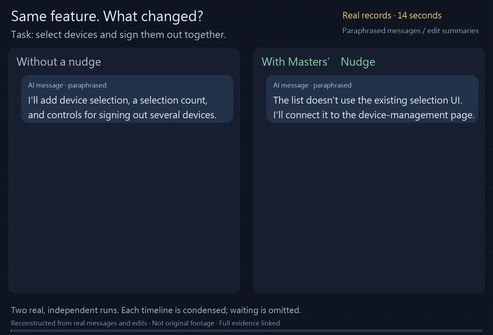
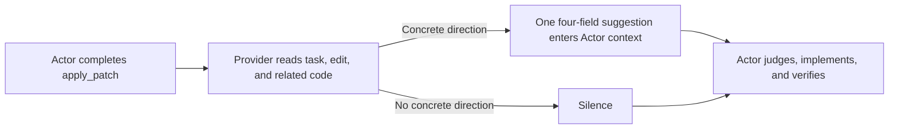

# Masters’ Nudge

English | [繁體中文](README.zh-TW.md)

> **Passing tests settles behavior, not design.**
>
> Green light means it passes now. What about six months later?

AI can implement a feature and pass its tests while the code still depends on synchronization, special branches, and local patches to stay correct. As requirements change, those workarounds can keep growing.

Masters’ Nudge aims to improve this: it adds a short structural suggestion while AI writes code, bringing an alternative data and responsibility arrangement into the next generation and making a better structure more likely.

## Watch the Actor receive a nudge and make its next edit

In Element’s device selection and bulk sign-out task, **both implementations passed the fixed acceptance checks.** After a nudge, the right-hand AI’s next edit required the selection list and updater as a pair and chose their source together.



*Chat reconstructed from actual records, with translated excerpts, paraphrased feedback and summarized edits. Work and waiting are condensed. [Source records and acceptance checks](docs/examples/element-live-recording.zh-TW.md).*

## Results and costs

The core benchmark compares direct implementation with structural feedback across **nine code-change tasks and seven model configurations**, measuring complete delivery, code structure and cost. Each task was attempted twice per configuration: 18 attempts per configuration, 126 total, from September 30 to October 4, 2026. Sol means GPT-6.1 Sol; Astra means GPT-6 Astra. Medium and xhigh are reasoning-depth settings. The coding model is the Actor; the feedback model is the Provider.

The remaining three tasks—Regexp, Metaflow and Tracing—are published separately as [unresolved challenges](benchmark/unresolved-challenges-20261004/README.zh-TW.md), as none of the seven configurations completed their full contracts.

**Sol xhigh with a Sol xhigh Provider maintained direct implementation’s 13/18 complete deliveries and achieved 7 wins, 0 losses and 4 ties in the 11 jointly completed code comparisons.** Taste assessment uses **Anonymous initial evaluation + whole-flow review**. The trade-off for this structural gain was +48.9% total time and +74.3% non-cached input tokens. Compared with a Sol medium Provider, it also improved completion and reviewed structure with +3.7% total time. The comparisons are:

| Comparison | Taste: wins / losses / ties | Total time | Non-cached input tokens |
|---|---|---|---|
| B vs A: Sol medium + Sol medium vs direct | 5 / 1 / 0 | +24.3% | +84.2% |
| F vs C: Sol xhigh + Sol medium vs direct | 3 / 3 / 2 | +43.6% | +50.7% |
| I vs C: Sol xhigh + Sol xhigh vs direct | 7 / 0 / 4 | +48.9% | +74.3% |
| I vs F: Provider medium → xhigh | 5 / 0 / 4 | +3.7% | +15.7% |

Anonymous initial evaluation compares X/Y implementations with their order swapped between judgments. Whole-flow review then examines the same implementations with configurations known, weighing whole-flow maintenance cost: added state, adapters, synchronization and compatibility work. In I versus C, two initial wins became ties, producing the final 7/0/4 result. The table uses final review results across 71 jointly completed task/attempt pairs. Time covers all 18 core attempts per configuration; tokens include Actor and Provider usage at the 16 positions with complete records across all seven configurations.

Complete deliveries were:

| Configuration | Coding model | Feedback model | Complete deliveries |
|---|---|---|---|
| A | Sol medium | None | 6/18 |
| B | Sol medium | Sol medium | 8/18 |
| C | Sol xhigh | None | 13/18 |
| D | Sol medium | Astra medium | 8/18 |
| E | Sol xhigh | Astra medium | 10/18 |
| F | Sol xhigh | Sol medium | 11/18 |
| I | Sol xhigh | Sol xhigh | 13/18 |

Complete delivery includes functionality, execution rules, the 30-minute deadline and uniform compatibility checks for original requirements. Delivery count is **C = I > F > E > B = D > A**. C has the lowest time per completed delivery; I pairs the same 13/18 delivery count with stronger reviewed structure. The jointly completed sample differs between taste comparisons.

See the [code-review results](benchmark/model-comparison-20261004/taste-review/README.zh-TW.md) for all final taste comparisons and their code evidence, and the [nine-task primary report](benchmark/model-comparison-20261004/PRIMARY.zh-TW.md) for task results, costs and detailed methods. The [methods and data](benchmark/README.zh-TW.md) explain how to audit tasks, code changes, acceptance checks, and judgments, and reconstruct statistics offline.

The [full twelve-task report](benchmark/model-comparison-20261004/REPORT.zh-TW.md) contains all 168 attempts, individual results and experimental details.

## What the tool does

The coding model is the Actor; the feedback model is the Provider. After an Actor edit, the Provider reads the task and related code and returns one short structural suggestion. It enters the Actor's context automatically. The Actor decides whether to adopt it and continues implementation and verification.



## Why a nudge can help

The Actor's next generation is shaped by the task, existing code, and its preceding approach. When a problem appears, adding another condition or special case offers a readily available continuation of the same local repair path.

A nudge injects a concrete alternative data and responsibility arrangement into that context. Removing the need for a workaround through structure becomes another candidate direction for subsequent generation. The aim is to influence the Actor's next token choices and increase the probability of adopting a better structure.

The Provider uses five taste criteria to find that direction: make invalid states unrepresentable, keep causality one-way and behavior predictable, give facts one authoritative source, and keep necessary complexity at real boundaries. Suggestions name checkable alternative relations so the Actor can judge and implement them. See the [behavior specification](SPEC.zh-TW.md) for the two selection steps, four-field format, and character limits.

## Limitations

- The Actor evaluates feedback, implements changes and verifies complete delivery.
- A turn stops after three suggestions or two silences, whichever comes first. Recognized test-only edits are skipped without a Provider call or allowance use.
- The Provider supports OpenAI/Codex only. Edits must arrive as explicit `apply_patch` content; opaque shell writes are unsupported.
- On the qualified Windows platform, interruption stops the Provider and preserves an interrupted fault; see [qualification](docs/qualification/README.zh-TW.md). Codex can still omit the matching `PostToolUse` completion event. See the [reproduction and tracking](https://github.com/openai/codex/issues/46765).

## Requirements

Supported installed platform: **Windows 11 x64**. Linux and macOS installed workflows are not qualified.

Requires the `python` command in the Codex launch environment to run Python 3.10+, a Git workspace, an executable and signed-in Codex CLI, and an Actor runtime supporting `UserPromptSubmit`, synchronous MCP `PostToolUse`, `Interrupt`, and `turn_id`.

Hooks and MCP share one Python entry point. Environments with only `py` or `python3` must first make `python` resolve to Python 3.10+ in Codex; restart Codex after changing PATH.

On Windows, the coding chat requires an enabled, supported [Windows sandbox implementation](https://learn.chatgpt.com/docs/windows/windows-sandbox).

The plugin version is declared in the [plugin manifest](plugins/masters-nudge/.codex-plugin/plugin.json). Provider reasoning is fixed at medium; the xhigh Provider in the comparison used an experimental setting. The default Provider model is `gpt-5.6-sol`; saved selections override it.

## Install, enable, and try it

1. Make sure Python, Git, and Codex CLI are installed. If the CLI is not signed in, run `codex login` in PowerShell.
2. In the Codex desktop Plugins page, choose **Add → Add Marketplace → Add from a repository**, enter `https://github.com/shihchengwei-lab/masters-nudge`, and select **Sync**. The repo's [marketplace](.agents/plugins/marketplace.json) exposes Masters’ Nudge; open it, install it, and enable it. See the [official installation steps](https://developers.openai.com/learn/developers-codex-plugin).
3. Review and trust the plugin hooks when Codex prompts you. In the CLI, use `/hooks` to inspect Masters’ Nudge's `UserPromptSubmit`, `PostToolUse`, and `Interrupt` hooks. See the [official hook guidance](https://learn.chatgpt.com/docs/hooks).
After updating an installed version, restart Codex. If a hook is marked modified, review and trust its new command before starting a new chat.

4. Open a new chat and ask Codex: “Check whether Masters’ Nudge is ready and set its Provider to gpt-6.1-sol.” The plugin supplies configuration and diagnostic skills; readiness checks dependencies, login, enablement and MCP tool discovery without calling the Provider.
5. Start a new chat in your own Git project and give the Actor a normal code change. After a product-code `apply_patch`, ask Codex: “Show recent Masters’ Nudge attempts.” `feedback` means a suggestion was produced; `silence` means a successful judgment found no suggestion. Faults have separate reasons. For feedback, inspect the four-field suggestion in the Actor context and the subsequent code changes.

If you downloaded this repo, you can also configure and inspect the tool manually from its root in PowerShell:

```powershell
python masters_nudge_cli.py provider set openai --model gpt-6.1-sol
python masters_nudge_cli.py doctor --host codex
python masters_nudge_cli.py recent-nudges --limit 10
```

## Privacy

Task text, edits, tool results, complete changed files that fit the shared material allowance, and file-origin facts are sent to OpenAI. The Provider has read-only access to non-ignored files in the Git workspace. The full task-start file list stays local; existence facts for paths in the current patch are sent.

Records default to `.masters-nudge/data/feedback.sqlite3` and settings to `.masters-nudge/config.json` under the user directory. `MASTERS_NUDGE_DATA_DIR` can override these locations.

## Development

Source files are the single implementation source; build commands generate the plugin copy:

```powershell
python tools/build_plugin.py --write
python tools/build_plugin.py --check
python -m unittest discover -s tests -v
```

See the [documentation index](docs/README.zh-TW.md) for usage, specifications, and development guidance.
