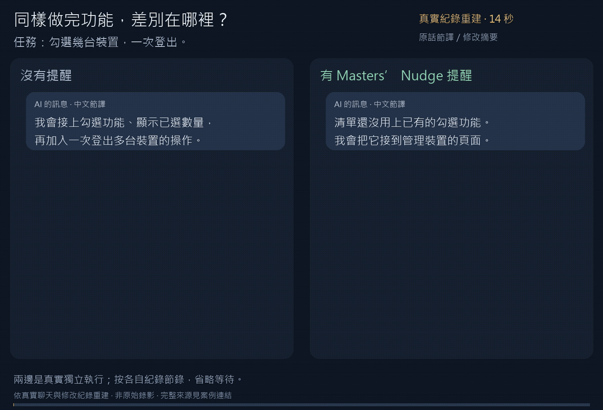
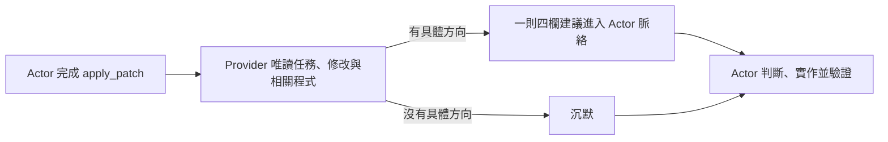

# Masters’ Nudge

繁體中文 | [English](README.md)

> **測試通過，只證明行為；不能證明設計。**
>
> 綠燈代表現在能過。六個月後呢？

AI 可以把功能做出來、讓測試通過，程式結構卻仍靠同步、特殊分支與局部補丁維持正確。需求再變，這些補救也可能繼續增加。

Masters’ Nudge 想改善這個問題：在 AI 寫程式的過程中，加入一則高品味結構的提醒，讓另一種資料與責任安排進入後續思考，增加產生更好結構的機會。

## 看 Actor 真正收到提醒，再修改程式

Element 的多裝置勾選與批次登出任務中，**兩份都通過固定驗收。** 右邊的 AI 收到提醒後，下一次修改把「顯示勾選結果」和「處理點選」綁在一起，讓兩者使用同一份紀錄。



*聊天畫面依真實紀錄重建，訊息採節譯、提醒採白話轉述，修改以摘要呈現；中間操作與等待省略。[原始紀錄與驗收](docs/examples/element-live-recording.zh-TW.md)。*

## 效果與代價

主要基準使用 **十二道程式修改任務、七種模型配置**，比較直接實作與加入結構提醒的完整交付、程式結構及成本。每題每配置各跑兩次，每配置24次，共168次；測試日期為 2026-09-30 至 10-04。Sol 指 GPT-6.1 Sol，Astra 指 GPT-6 Astra；medium 與 xhigh 是不同的思考深度。寫程式的模型稱為 Actor，提供提醒的模型稱為 Provider。

**先前未解的 Regexp、Metaflow、Tracing 三題，現在都已通過完整固定驗收。** 2026-10-17，以 Sol xhigh 同時擔任 Actor 與 Provider，帶入先前失敗反例與成功部分，從既有實作續解：Regexp 通過 4/4 組檢查、Metaflow 9/9、Tracing 4/4；Actor 用時分別為12分52秒、7分20秒、17分27秒，包含 Provider 與測試等待。[續解結果、程式與證據](benchmark/unresolved-challenges-20261004/continuation-20261017/README.zh-TW.md)另列呈現；原研究的失敗仍計入十二題比較，[先前探索紀錄](benchmark/unresolved-challenges-20261004/README.zh-TW.md)完整保留。

**Sol xhigh 搭配 Sol xhigh Provider，維持直接實作的 13/24 完整交付，並在共同完成的11組程式碼比較中取得7勝、0敗、4平。** 品味評估採**匿名初評＋完整流程覆核**。這項結構收益的代價是累計時間增加26.9%、未快取輸入 Token 增加73.1%。相對 Sol medium Provider，完整交付與結構覆核結果也改善，累計時間減少0.6%。各組結果如下：

| 比較條件 | 前者品味：勝／敗／持平 | 累計時間 | 未快取輸入 Token |
|---|---|---|---|
| B 對 A：Sol medium＋Sol medium 對直接做 | 5／1／0 | +14.2% | +88.9% |
| F 對 C：Sol xhigh＋Sol medium 對直接做 | 3／3／2 | +27.7% | +51.1% |
| I 對 C：Sol xhigh＋Sol xhigh 對直接做 | 7／0／4 | +26.9% | +73.1% |
| I 對 F：Provider medium→xhigh | 5／0／4 | −0.6% | +14.5% |

匿名初評比較 X/Y，並交換呈現順序；完整流程覆核則在已知配置下檢查同一批程式，將新增狀態、轉接、同步與相容處理納入完整流程的維護成本。I 對 C 的兩場初評勝利改為持平，得到最終7／0／4。表格沿用原71組共同完整交付的同題／同次序複評結果。時間涵蓋十二題每配置全部24次嘗試，包含失敗；Token 使用七種配置共同19個有完整用量的位置，包含 Actor 與 Provider。

完整交付結果如下：

| 配置 | 寫程式的模型 | 提供提醒的模型 | 完整交付 |
|---|---|---|---|
| A | Sol medium | 無 | 6/24 |
| B | Sol medium | Sol medium | 8/24 |
| C | Sol xhigh | 無 | 13/24 |
| D | Sol medium | Astra medium | 8/24 |
| E | Sol xhigh | Astra medium | 10/24 |
| F | Sol xhigh | Sol medium | 11/24 |
| I | Sol xhigh | Sol xhigh | 13/24 |

完整交付包含功能、執行規則、30 分鐘時限及相同原條款的相容性補查。完成份數為 **C = I > F > E > B = D > A**。C 的每份完整交付耗時最低；I 在同樣13/24的完整交付下，取得更好的結構覆核結果。各組品味比較的共同完成樣本不同。

最終品味評比與程式依據見[程式碼覆核報告](benchmark/model-comparison-20261004/taste-review/README.zh-TW.md)；全部168次嘗試、逐題完成、成本與詳細方法見[十二題主要報告](benchmark/model-comparison-20261004/REPORT.zh-TW.md)。[測試方法與數據](benchmark/README.zh-TW.md)說明如何查驗題目、程式修改、驗收與評審紀錄，並離線重建統計。

[九題事後子集分析](benchmark/model-comparison-20261004/PRIMARY.zh-TW.md)保留為補充，每配置18次，排除原研究中所有配置均未完成的三題；上方主要結果涵蓋全部十二題。

## 工具做了什麼

寫程式的模型稱為 Actor，提供提醒的模型稱為 Provider。Actor 完成一次修改後，Provider 唯讀檢查任務與相關程式，提出一則簡短的結構建議；建議自動進入 Actor 的上下文，Actor 決定是否採納並繼續實作與驗證。



## 作用原理

Actor 的後續生成受任務、既有程式與前面的解題脈絡影響。遇到問題時，沿著原本方向加一個判斷或特例，是一條容易延續的局部修補路徑。

Nudge 把另一種具體的資料與責任安排注入上下文，讓「從結構上消除補救」也成為後續生成的候選方向。它希望影響 Actor 接下來選中的 token，提高採用更好結構的機率。

Provider 用五條品味準則尋找這種方向：讓非法狀態無法表達、保持單向因果與可預測行為、讓事實只有一個權威來源，以及把必要複雜度留在真正的邊界。提醒聚焦可檢查的替代關係，讓 Actor 能判斷並實作。兩步選題、四欄格式與字元額度見[行為規格](SPEC.zh-TW.md)。

## 限制

- Actor 負責判斷提醒、實作與驗證完整交付。
- 每輪最多三則建議或兩次沉默，先到任一上限就停止。可辨識的純測試修改直接略過，不呼叫 Provider、不耗額度。
- Provider 只支援 OpenAI／Codex。只觀察明確的 `apply_patch` 修改，無法觀察沒有提供修改內容的命令列寫檔。
- 已驗證的 Windows 平台上，中斷會停止 Provider 並保留中斷故障紀錄，詳見[驗證紀錄](docs/qualification/README.zh-TW.md)。Codex 仍可能缺少對應的 `PostToolUse` 完成事件；詳見[重現與追蹤](https://github.com/openai/codex/issues/46765)。

## 環境需求

已驗證並支援的安裝平台為 **Windows 11 x64**；Linux 與 macOS 的安裝流程尚未完成驗證。

需要 Codex 啟動環境的 `python` 命令指向 Python 3.10+、Git 工作區、可啟動且已登入的 Codex CLI，以及支援 `UserPromptSubmit`、同步 MCP `PostToolUse`、`Interrupt` 與 `turn_id` 的 Actor 執行環境。

Hook 與 MCP 共用 Python 入口。只有 `py` 或 `python3` 的環境，需要先讓 Codex 的 `python` 命令指向 Python 3.10+；修改 PATH 後重新開啟 Codex。

Windows 的寫程式聊天還需要已啟用、受支援的 [Windows 沙箱執行方式](https://learn.chatgpt.com/docs/windows/windows-sandbox)。

外掛版本記載於[外掛清單](plugins/masters-nudge/.codex-plugin/plugin.json)。Provider 模型預設 `auto`，跟隨 Codex 當前推薦模型，repo 不寫死某一代模型；使用者自行指定的模型則固定保留。思考深度預設 `medium`，可自行設定或請 Agent 調整。各代模型的能力、支援深度、等待時間與用量不同，由使用者選擇合適組合，詳見 [Codex 模型選擇](https://learn.chatgpt.com/docs/models#configure-your-default-local-model)。

## 安裝、啟用與第一次使用

1. 確認 Python、Git 與 Codex CLI 已安裝；若 CLI 尚未登入，在 PowerShell 執行 `codex login`。
2. 在 Codex 桌面版的外掛頁，選 **Add → Add Marketplace → Add from a repository**，填入 `https://github.com/shihchengwei-lab/masters-nudge`，按 **Sync**。repo 的[外掛目錄](.agents/plugins/marketplace.json)提供 Masters’ Nudge；開啟它並安裝、啟用。來源與安裝介面可參照[官方步驟](https://developers.openai.com/learn/developers-codex-plugin)。
3. 依 Codex 的提示檢查並信任外掛 Hook。CLI 可輸入 `/hooks`，核對 Masters’ Nudge 的 `UserPromptSubmit`、`PostToolUse` 與 `Interrupt`，詳見[官方 Hook 說明](https://learn.chatgpt.com/docs/hooks)。
更新已安裝的版本後，重新開啟 Codex；若 hook 被標為「已修改」，檢查新命令後重新信任，再開始新對話。

4. 開啟新對話，請 Codex：「檢查 Masters’ Nudge 是否已就緒，顯示 Provider 模型與思考深度。」外掛提供設定與診斷技能；就緒檢查會列出依賴、登入、啟用狀態，並使用 Codex 實際載入的 MCP 命令檢查初始化與工具探索；不呼叫 Provider。
5. 在自己的 Git 專案開啟新對話，交給 Actor 一項正常的程式修改。完成一次產品程式的 `apply_patch` 後，請 Codex：「顯示 Masters’ Nudge 最近的提醒紀錄。」`feedback` 表示已產生建議，`silence` 表示正常判斷後沒有建議；工具故障會另列原因。若有建議，可核對 Actor 上下文中的四欄提醒與後續程式改動。

需要調整時，可請 Agent 設定你選擇的模型與深度，或改回 `auto` 搭配 `medium`；兩項可以分開修改。儲存後重新開啟 Codex，或重新連線 Nudge MCP，使常駐服務載入設定。這只影響 Provider，不更換 Actor。

如果已下載本 repo，也可在 repo 根目錄用 PowerShell 手動設定與查詢：

```powershell
python masters_nudge_cli.py provider set openai --model auto --reasoning-effort medium
python masters_nudge_cli.py provider get --host codex
python masters_nudge_cli.py doctor --host codex
python masters_nudge_cli.py recent-nudges --limit 10
```

## 隱私

任務原文、修改、工具結果、可完整放入共同材料額度的已修改檔案，以及檔案來源事實會傳給 OpenAI。Provider 可唯讀 Git 工作區中的未忽略檔案。完整任務起點檔案清單只保存在本機，送出時附本批路徑是否原本存在。

預設紀錄存於使用者目錄的 `.masters-nudge/data/feedback.sqlite3`，設定存於 `.masters-nudge/config.json`。`MASTERS_NUDGE_DATA_DIR` 可覆蓋位置。

## 開發

原始碼是唯一實作來源，外掛副本由建置指令產生：

```powershell
python tools/build_plugin.py --write
python tools/build_plugin.py --check
python -m unittest discover -s tests -v
```

使用、規格與開發文件見[文件索引](docs/README.zh-TW.md)。
